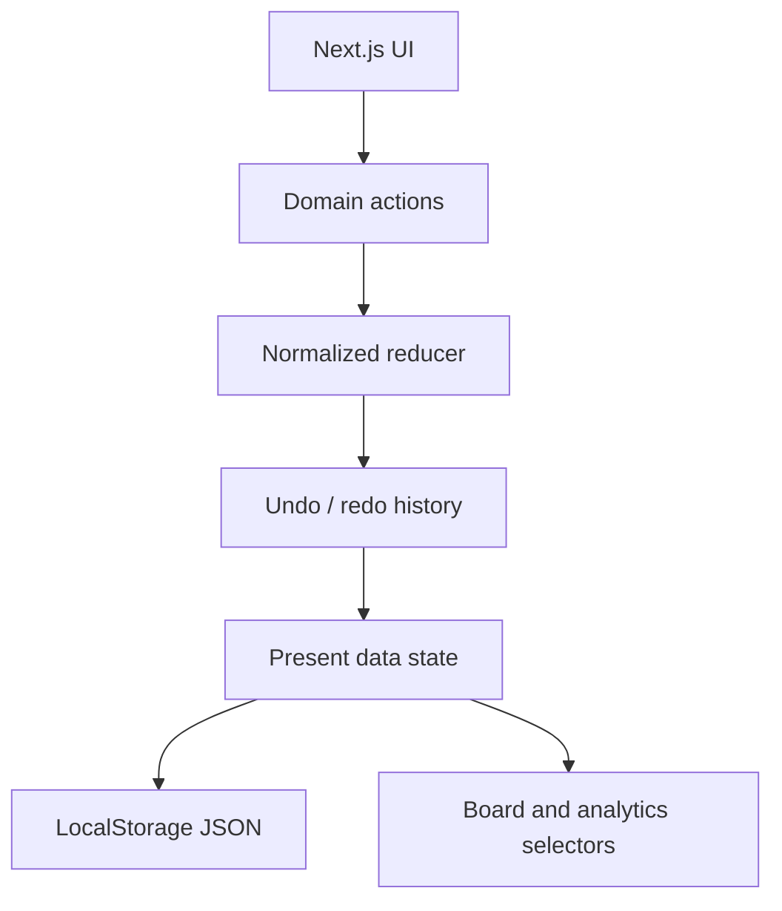

# Kanban Studio

A local-first project management workspace built with Next.js App Router, React, TypeScript, Tailwind CSS and dnd-kit.

## Run locally

```bash
npm install
npm run dev
```

Open http://localhost:3000. Create a production build with `npm run build`, then run it with `npm start`.

## Folder structure

```text
kanban-studio-final/
├── src/
│   ├── app/          # Next.js routes, layout and global styles
│   ├── components/   # Reusable UI and the main Kanban screen
│   └── lib/          # Domain types, seed data and state management
├── public/           # Static assets
├── package.json      # Scripts and dependencies
├── tsconfig.json     # TypeScript and @/* -> src/* alias
├── tailwind.config.ts
├── postcss.config.js
└── next.config.ts
```

## Included

- Multiple boards: create, switch, duplicate and delete.
- Board templates: Sprint Planning, Content Calendar and Job Hunt.
- Custom columns, task create/edit/delete, priorities, labels and due dates.
- Drag-and-drop between columns and keyboard sortable sensor.
- Task checklists, compact/comfortable density, light/dark themes.
- Search and filters for labels, priority and due status.
- Command palette (`Ctrl/Cmd + K`), `N` new task, undo/redo (`Ctrl/Cmd + Z`, `Ctrl/Cmd + Shift + Z`).
- Analytics snapshot, activity events for card moves, JSON import/export.
- LocalStorage persistence and responsive horizontally scrolling board.

## Architecture

State is normalized into ID-keyed dictionaries (`boards`, `columns`, `cards`, `labels`). A reducer applies domain actions. `HistoryState` wraps the data state in `past`, `present` and `future` snapshots. This makes entity lookup O(1) by ID; immutable array reordering remains O(n). Browser persistence stores only the serializable present state as JSON.



## Important scope notes

This is a frontend-only, single-browser application. LocalStorage is not a shared database and does not provide accounts, collaboration, server-side authorization, or cross-device sync. Do not put confidential data in a shared/public browser profile. For multi-user production use, add an authenticated API and database.

The analytics screen is a current-state snapshot with a lightweight movement activity feed, not a server-backed historical reporting system. The starter board is generic demo content and can be deleted.

## Deployment

Import the repository into Vercel or another Next.js host. The app is static-client oriented and requires no environment variables. Data remains in each user's browser; deploying does not synchronize workspaces between users.
